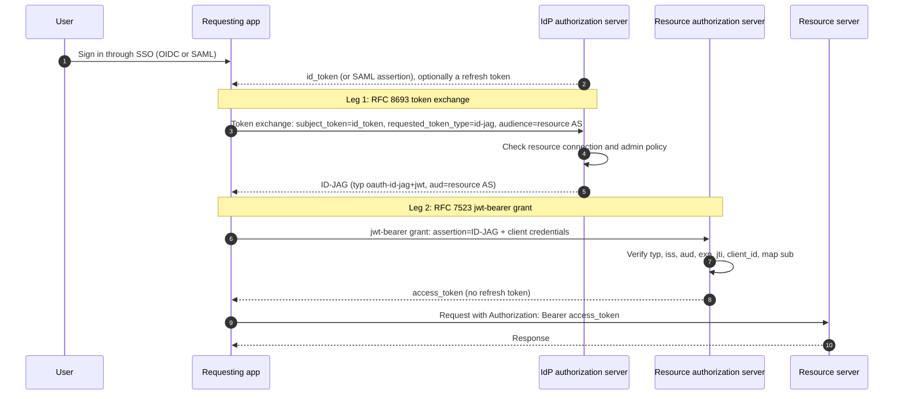

# ID-JAG (Cross App Access)

ID-JAG is the Identity Assertion Authorization Grant, defined in [draft-ietf-oauth-identity-assertion-authz-grant](https://datatracker.ietf.org/doc/html/draft-ietf-oauth-identity-assertion-authz-grant). It lets an application that already signed a user in with the company identity provider reach a second application on that user's behalf, without a browser consent screen. The identity provider decides whether the two apps may talk, and an administrator controls that in the identity provider console. Okta ships the feature as [Cross App Access (XAA)](https://developer.okta.com/docs/concepts/xaa/).

LiteLLM can stand on either side of this exchange. As the **resource app**, LiteLLM's gateway token endpoint accepts an ID-JAG from an outside agent and mints a proxy credential for the user named in it. As the **requesting app**, LiteLLM exchanges the identity assertion it captured at SSO login for an ID-JAG and redeems that at an MCP server's authorization server. The two pages in this folder walk through one side each.

| Page | LiteLLM's role | What you get |
|------|----------------|--------------|
| [LiteLLM as resource app](./resource_app.md) | The app being reached. An agent signed in with your IdP trades an ID-JAG for a LiteLLM credential at `POST /token`. | Agents reach LiteLLM's MCP gateway and API as the signed-in user with no browser step and no long-lived key. |
| [LiteLLM as requesting app](./requesting_app.md) | The app doing the reaching. LiteLLM trades the user's SSO assertion for an ID-JAG and then for an MCP access token. | Agents holding only a virtual key reach MCP servers that trust a separate authorization server, as the user the key belongs to. |

## The parties

The IETF draft names four roles, and Okta's console uses close variants of the same words.

| Draft term | Okta term | Meaning |
|------------|-----------|---------|
| IdP authorization server | Org authorization server (`https://<your-org>.okta.com/oauth2/v1`) | Signs users in and issues the ID-JAG. The ID-JAG always comes from here, never from a custom authorization server. |
| Client | Requesting app, registered as an **AI agent** | The app acting for the user. It presents the user's identity assertion and receives the ID-JAG. |
| Resource authorization server | Resource app's authorization server, the **Issuer URL** on the Resource Server tab | Validates the ID-JAG and issues its own access token. Its issuer identifier is the ID-JAG `aud`. |
| Resource server | Resource app | The API the access token is used on. |

The link between a requesting app and a resource app is a **resource connection**. An Okta admin creates it under the AI agent and picks the scopes it may ask for. Without it the token exchange fails, however the user signed in.

## How the whole flow runs

Leg 1 always runs against the identity provider. Leg 2 runs against whoever protects the resource. When LiteLLM is the resource app, LiteLLM is the resource authorization server and the resource server at once, and leg 2 lands on `POST /token` at your LiteLLM domain. When LiteLLM is the requesting app, LiteLLM runs both legs itself before it calls the MCP server.

## How ID-JAG relates to the other LiteLLM auth modes

ID-JAG extends the JWT and token exchange features LiteLLM already has. It does not replace them, and both pages in this folder build on them.

[JWT authentication](../token_auth.md) is one authorization server. The client gets an access token from the IdP with LiteLLM's audience and sends it as a bearer token. LiteLLM verifies it against the issuer's JWKS and maps `sub` or an email claim to a user. ID-JAG reuses exactly this trust: the same `issuers` entry and the same `user_id_jwt_field` and `user_email_jwt_field` mapping verify the ID-JAG and resolve its user. The difference is that an ID-JAG is a grant, not a bearer token. LiteLLM refuses it on `/mcp` and only accepts it at the token endpoint.

[OBO token exchange](../../mcp_obo_auth.md) is one RFC 8693 exchange against one authorization server. LiteLLM trades the caller's inbound token for a token the MCP server accepts, and that works when the MCP server trusts the same IdP that signed the user in. ID-JAG is for the case where it does not. The IdP issues a grant, the MCP server's own authorization server mints the access token, and the admin controls the connection in the IdP instead of a consent screen.

| | JWT authentication | OBO token exchange | ID-JAG |
|---|---|---|---|
| Authorization servers involved | One | One | Two |
| Who mints the token LiteLLM or the MCP server accepts | The IdP | The IdP | The resource app's authorization server |
| Who approves app-to-app access | Nobody, the token's audience decides | The IdP's token exchange policy | An admin, in the IdP console, per resource connection |
| Browser consent | No | No | No |
| Where the user's identity comes from | Bearer token on the request | Bearer token on the request | The request's `id_token`, or the assertion captured at SSO login |

## Requirements

Both roles need an enterprise license and a database. The resource app side also needs [JWT authentication](../token_auth.md) enabled, since the ID-JAG is verified with that issuer configuration. On the Okta side, the requesting app is registered as an AI agent, which needs the Okta for AI Agents entitlement, and the resource app is registered as an app integration with Cross App Access enabled on its Resource Server tab. The pages in this folder label every Okta Admin Console step as such. The LiteLLM side is the same for any identity provider that implements the draft.
